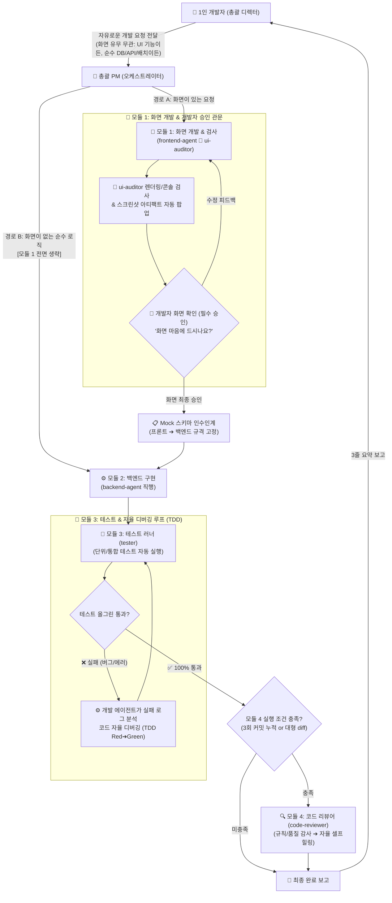

# Antigravity 자율 멀티 에이전트 팀 오케스트레이션 가이드 (Multi-Agent Guide)

본 문서는 Google Antigravity 환경에서 1인 개발자가 **"자율 멀티 에이전트 팀(Autonomous Multi-Agent Team)"** 을 지휘하여 단일 대화창의 한계를 극복하고, 역할별 전문 에이전트 분담, 프론트 선검증 ➔ 스크린샷 확인 ➔ 백엔드 인수인계, 그리고 자동 테스트/코드리뷰를 수행하는 실전 가이드입니다.

---

## 1. 왜 멀티 에이전트인가? (멘탈 모델과 핵심 가치)

### 1.1 단일 대화창의 한계: "컨텍스트 오염 (Context Drift)"
혼자서 모든 것을 다 하는 단일 AI 대화창에 수십 개의 소스 파일, 긴 기술 문서, 디버깅 로그를 계속 입력하면 다음과 같은 문제가 발생합니다:
- **기억력 감퇴**: 대화가 길어질수록 초기에 합의한 PRD 규칙이나 아키텍처 원칙을 망각합니다.
- **추론 지능 저하**: 컨텍스트 윈도우가 가득 차면 코드 생성 품질이 급격히 떨어집니다.
- **마이크로매니징 피로**: 개발자가 사소한 단계마다 지시하고 확인하느라 피로도가 누적됩니다.

### 1.2 멀티 에이전트의 해결책: "소프트웨어 총괄 디렉터"
1인 개발자는 사소한 코딩을 일일이 지시하는 코더가 아닌 **"소프트웨어 총괄 디렉터(의사결정자)"** 가 됩니다.
- 총괄 PM이 개발자의 한마디에서 의도를 분석하여 전문 에이전트에게 작업을 분배합니다.
- 화면 디자인 확인은 사람이 직접 눈으로 보고 승인합니다.
- 복잡한 코드 작성, 테스트 디버깅, 린트 감사는 에이전트들이 각자의 격리된 세션(`branch`)에서 자율적으로 처리합니다.

---

## 2. 전문 에이전트 역할 체계

| 역할 | 에이전트명 | 권한/도구 | 워크스페이스 | 필수 참조 스킬 | 핵심 임무 |
| :--- | :--- | :--- | :--- | :--- | :--- |
| **총괄 PM** | `pm` (메인 세션) | 전체 도구 | `inherit` | - | **오케스트레이터**: 사용자 요구사항 분석, 모듈 분배, 진행 상황 취합 및 최종 승인 요청 |
| **프론트/UI** | `frontend-agent` | 쓰기 + 실행 | `branch` (격리) | `ui-ux-pro-max`, `seo` | **화면 선구현**: 디자인 시스템/시맨틱 마크업 기반 모던 CSS/Headless UI 개발, 입출력 스키마 선언 |
| **백엔드/API** | `backend-agent` | 쓰기 + 실행 | `branch` (격리) | `tdd` | **비즈니스 로직**: Seam 기반 수직 슬라이스 TDD, 프론트 스키마 기반 API/DB 구현 |
| **화면 검사관** | `ui-auditor` | Chrome DevTools MCP | `inherit` | - | **화면 자동 검사**: 모바일/데스크톱 뷰포트 렌더링, 콘솔 에러 검사 및 **스크린샷 아티팩트 자동 팝업** |
| **테스트 러너** | `tester` | Vitest, Jest, Pytest | `branch` (격리) | `tdd` | **자동 테스트**: 단위/통합 테스트 자동 실행 및 실패 시 에러 로그 추출 |
| **코드 리뷰어** | `code-reviewer` | 읽기 전용 (Read-Only) | `inherit` | `code-review` | **2축 독립 감사**: 3회 커밋 시 Spec(PRD) & Standards(8대 규칙/코드스멜) 정밀 감사 및 셀프힐링 |

---

## 3. 4대 독립 모듈 파이프라인 (Modular Pipeline)

전체 시스템은 서로 독립적으로 작동할 수 있는 **4대 모듈** 로 구성되며, 작업 성격에 따라 필요한 모듈만 유연하게 조합하여 실행됩니다:



---

### 모듈 1. 화면 개발 & 검사 모듈 (`frontend-agent` 🔄 `ui-auditor`)
1. **Mock UI 선구현**: `frontend-agent` 가 설치된 **`ui-ux-pro-max`** (디자인 시스템, 컴포넌트 인터랙션) 및 **`seo`** (시맨틱 HTML 마크업, OG 태그) 스킬을 필수로 참조하여 모던 CSS와 Headless UI로 화면을 구현하고, `types/` 에 입출력 스키마를 선언합니다.
2. **화면 검사관 자율 검사**: `ui-auditor` (Chrome DevTools MCP)가 모바일 뷰포트(375px)와 데스크톱에서 렌더링 깨짐과 콘솔 에러를 검사하며, 문제 발생 시 프론트엔드가 자율 수정합니다.
3. **🛑 개발자 필수 승인 관문**: 검사 통과 시 최신 화면을 **우측 Sidecar Artifact 패널에 `.png` 이미지로 자동 표시** 합니다.
   - 개발자가 채팅창 옆 스크린샷을 확인하고 "OK" 승인해야만 비로소 모듈 2(백엔드)로 진입합니다.
   - 수정 요청 시 피드백과 함께 프론트엔드로 루프백됩니다.

### 모듈 2. 백엔드 구현 모듈 (`backend-agent`)
1. **TDD 기반 비즈니스 로직**: `backend-agent` 가 설치된 **`tdd`** (수직 슬라이스, Seam 기반 공개 인터페이스 검증, AI 동어반복 단언 방지) 스킬을 필수로 참조하여 비즈니스 로직 및 API를 개발합니다.
2. **화면이 있는 기능**: 모듈 1에서 개발자가 승인한 Mock 스키마 인터페이스를 100% 계승하여 API 엔드포인트와 DB 쿼리를 결합합니다 (필드명 불일치 0%).
3. **화면이 없는 기능 (DB, API, 배치, 계산 로직 등)**: 모듈 1(화면/검사관/스크린샷)을 완전히 건너뛰고 **`backend-agent` 로 즉시 직행** 하여 로직을 개발합니다.

### 모듈 3. 자동 테스트 & 자율 디버깅 모듈 (`tester`)
1. **자동 실행**: 구현 완료 즉시 `tester` 가 단위/통합 테스트를 실행합니다.
2. **자율 디버깅 루프 (TDD)**:
   - ❌ 테스트 실패 시 개발자를 부르지 않고 에러 스택 트레이스를 개발 에이전트에게 전달합니다.
   - 개발 에이전트가 코드를 스스로 수정하고 `tester` 가 재검증하여 **100% 올그린(All Green) 달성 시에만 통과** 합니다.
   - *(단, 3회 이상 자율 수정 실패 시에만 개발자에게 원인 보고 및 조언 요청)*

### 모듈 4. 조건부 품질 감사 모듈 (`code-reviewer`)
1. **트리거 조건**: 매번 실행하지 않고, **누적 3회 커밋 달성 시** 또는 **대규모 코드 추가/수정 발생 시** 에만 출격합니다.
2. **2축(Two-Axis) 독립 감사**: 설치된 **`code-review`** 스킬을 참조하여 다음 2개 축으로 분리 감사하고, 미흡한 부분을 개발 에이전트에게 전달하여 자율 셀프힐링 커밋을 생성하게 합니다:
   - **규격 축 (Spec)**: [PRD.md](../PRD.md) 요구사항을 완벽히 충족했는가?
   - **표준 축 (Standards)**: `rules/` 8대 규칙 및 클린 코드 스멜을 준수했는가?

---

## 4. 실전 시나리오 예시

```text
개발자: "사용자 프로필 수정 화면이랑 닉네임 중복 확인 API 구현해줘."
```

1. **[모듈 1 실행]**: `frontend-agent` 가 프로필 수정 모달 구현 ➔ `ui-auditor` 가 렌더링 검사 후 스크린샷 팝업 ➔ 개발자: *"좋아, 화면 통과. 백엔드 진행해."* (승인)
2. **[모듈 2 실행]**: `backend-agent` 가 프론트 스키마를 이어받아 닉네임 중복 확인 API 및 DB 쿼리 구현.
3. **[모듈 3 실행]**: `tester` 가 테스트 실행 ➔ 1건 실패(특수문자 예외 누락) 발견 ➔ `backend-agent` 에 전달하여 자율 수정 ➔ 8/8 전원 통과.
4. **[모듈 4 조건 검사]**: 누적 3회 커밋 미도달로 패스.
5. **[최종 보고]**:
   ```text
   프로필 수정 UI 및 닉네임 중복 확인 API 연동이 완료되었습니다.
   - 📸 화면 스크린샷: 아티팩트 확인 완료 (모바일 뷰포트 정상)
   - 🧪 테스트 결과: 단위 테스트 8/8 통과
   커밋 승인하시겠습니까?
   ```

---

## 5. 공식 행동 규칙 참조 (Official Operating Rules)

서브에이전트의 구체적인 역할 분담, 파이프라인 시퀀스 및 화면 승인 필수 관문 규약은 공식 규칙 파일인 **[rules/multi-agent-ko.md](../rules/multi-agent-ko.md)** (영문: **[rules/multi-agent.md](../rules/multi-agent.md)**)에 명문화되어 있습니다.

모든 에이전트는 해당 공식 규칙을 시스템 수준에서 준수하며, 개발자는 별도의 수동 조작 없이 자연어 개발 지시와 화면 승인 게이트만 통제하시면 됩니다.
